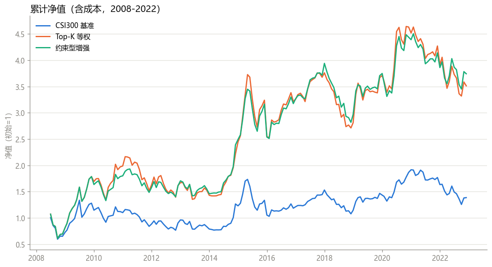
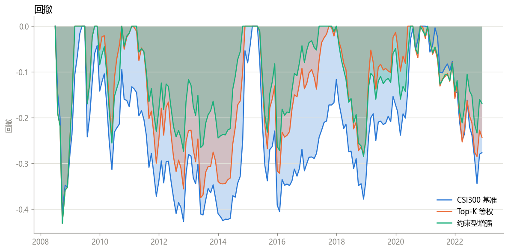

# 沪深300多因子 Alpha 研究与约束型指数增强

本项目在历史时点的沪深300成分股中，完成一条从候选因子定义、截面预处理、单因子检验、多因子合成，到组合构建、成本回测、归因与扩展样本外验证的研究链路。

项目并非逐篇复制研报。研究过程借鉴公开券商多因子研究的评价口径，但因子选择、数据处理、组合比较和结论均基于本项目数据独立完成。所有已知数据限制和实现近似均在本文与研究协议中明确记录。

## 1. 研究问题

1. 价值、质量、成长、动量/反转、低波和流动性因子中，哪些在沪深300历史成分股内具有稳定的横截面预测能力？
2. 因子去极值、市值与行业中性化后，多因子合成能否优于单因子？
3. 同一综合 Alpha 下，约束型指数增强能否比简单 Top-K 组合取得更好的收益、回撤与换手表现？
4. 结论在测试期和后续扩展样本外是否仍然成立，在哪些市场阶段会失效？

## 2. 研究设计

| 项目 | 设定 |
|---|---|
| 股票池 | 每个历史时点的沪深300成分股，包含后来退市股票 |
| 数据源 | JQData 日频行情、估值与按公告日对齐的财务数据 |
| 候选因子 | 9 个：价值、质量、成长、动量/反转、低波、流动性 |
| 训练期 | 2008–2019，用于因子筛选及合成规则确定 |
| 测试期 | 2020–2022，不参与规则选择 |
| 扩展样本外 | 2023–2025，使用聚宽平台独立验证 |
| 预处理 | 截面 MAD 缩尾、行业与对数市值中性化、截面标准化 |
| 调仓 | 月度；信号使用上一期已知数据 |
| 本地成交口径 | `t+1` 收盘价近似成交 |
| 聚宽成交口径 | `t+1` 开盘执行，并由平台交易规则处理订单 |

财务数据按公告日进入样本，历史股票池按当时成分构建。因子方向、筛选阈值和 Alpha 合成规则仅使用训练期信息。

## 3. 因子研究

首版冻结 9 个候选因子。以训练期 RankICIR 为主要筛选依据，最终保留 6 个；12-1 动量、应计质量和低杠杆因子未达到训练期筛选要求，未进入正式 Alpha。

| 保留因子 | 经济方向 | 训练期 RankIC | 训练期 RankICIR | 测试期 RankIC | 测试期 RankICIR |
|---|---:|---:|---:|---:|---:|
| 1 月反转 | 低近期收益更优 | 0.0668 | 0.559 | 0.0367 | 0.398 |
| 价值 EP | 高盈利收益率更优 | 0.0460 | 0.537 | 0.0075 | 0.081 |
| 特异低波 | 低特异波动更优 | 0.0572 | 0.434 | 0.0803 | 0.712 |
| 质量 ROE | 高 ROE 更优 | 0.0362 | 0.396 | 0.0113 | 0.138 |
| 低换手 | 低换手率更优 | 0.0486 | 0.387 | 0.0525 | 0.482 |
| 营收成长 | 高营收增速更优 | 0.0262 | 0.377 | 0.0093 | 0.144 |

五分组检验中，6 个保留因子的 Q5−Q1 收益均为正，分组单调性为 0.8–1.0；其中 1 月反转的多空月均收益约为 1.84%。年度 IC、分组收益和淘汰因子的结果均保留在 `results/factor_tests/`，未删除失败结果。

## 4. Alpha 合成

项目比较了等权、训练期 IC 加权和基于训练期 IC 协方差的调整权重。这里的“风险调整”仅指因子 IC 协方差调整，不代表组合层已经建立商业级风险模型。

| 合成方法 | 训练期 RankIC | 训练期 RankICIR | 测试期 RankIC | 测试期 RankICIR |
|---|---:|---:|---:|---:|
| 等权 | 0.0871 | 0.938 | 0.0707 | **0.853** |
| 训练期 IC 加权 | 0.0886 | 0.951 | 0.0708 | 0.817 |
| IC 协方差调整 | 0.0763 | 0.879 | 0.0405 | 0.567 |

等权合成在测试期最稳健，因此作为主组合信号。复杂权重没有自动带来更好的样本外结果。

## 5. 组合构建

在相同综合 Alpha 下比较：

- 沪深300基准近似组合；
- Top-K 等权组合；
- 约束型指数增强组合。

约束型组合目标为预期 Alpha 减去换手惩罚，约束包括全额投资、禁止做空、单只股票权重上限、相对基准的主动权重上限和行业主动偏离上限。当前版本**没有**显式协方差风险项、跟踪误差约束或优化目标中的交易成本惩罚；交易成本在回测层统一扣减。

## 6. 本地回测结果

回测区间为 2008–2022，共 174 个有效月度调仓截面。本地净收益使用统一成本近似：

```text
净收益 = 毛收益 − 月度换手率 × 往返成本
```

| 组合 | 年化收益 | 年化波动 | Sharpe | 累计收益 | 最大回撤 | 月均换手 |
|---|---:|---:|---:|---:|---:|---:|
| 沪深300基准近似 | 2.28% | 25.61% | 0.089 | 38.68% | -42.71% | — |
| Top-50 等权 | 3.60% | 24.79% | 0.145 | 66.94% | -42.23% | 44.75% |
| 约束型指数增强 | **4.86%** | **23.00%** | **0.211** | **98.89%** | **-38.53%** | **31.64%** |

该结果表明，约束型组合在这段历史样本中同时改善了收益、回撤和换手。但 Sharpe 绝对值仍然不高，不能据此将策略描述为高收益或可直接实盘。

### Top-K 稳健性

| K | 年化收益 | Sharpe | 月均换手 |
|---:|---:|---:|---:|
| 30 | 4.27% | 0.168 | 51.73% |
| 50 | 3.60% | 0.145 | 44.75% |
| 80 | 2.74% | 0.111 | 38.07% |

K 从 30 扩大至 80 后，收益下降而换手同步降低；主结论不依赖单一 K，但收益与集中度之间存在明确权衡。

## 7. 聚宽平台验证与扩展样本外

聚宽版本位于 `src/backtest/joinquant_backtest.py`，用于验证平台交易规则下的订单执行。由于本地回测与聚宽回测在成交价格、基准和有效起始日期上不完全一致，两组数值不做逐点对齐。

- 聚宽独立回测：策略年化收益 1.62%，信息比率 0.53，Alpha 0.039，Beta 1.02。
- 2023–2025 扩展样本外：策略年化收益 8.90%，累计超额 21.40%，Sharpe 0.31。

扩展样本外仍保留正超额，但 2021–2022 的价值和质量因子出现明显衰减，说明因子表现具有市场状态依赖性。

## 8. 图表与结果文件

### 净值曲线



### 回撤曲线



主要结果文件：

- `results/factor_tests/factor_summary.csv`：训练期与测试期 IC/RankIC 统计；
- `results/factor_tests/factor_annual_ic.csv`：逐年 IC 稳定性；
- `results/factor_tests/grouping_summary.csv`：五分组收益、Q5−Q1 与单调性；
- `results/factor_tests/alpha_comparison.csv`：三类 Alpha 合成比较；
- `results/backtests/backtest_summary.csv`：主回测绩效；
- `results/backtests/robustness_topk.csv`：Top-K 稳健性；
- `results/attribution/annual_returns.csv`：年度收益与超额；
- `results/attribution/factor_tilts.csv`：组合因子暴露。

## 9. 已知边界

- 行业分类使用外部静态 2025 版申万一级映射，覆盖约 94% 的历史成分股，但并非严格的历史时点行业数据，存在轻微前视风险。
- 基准权重以截面市值权重近似，不是中证指数公司发布的真实历史权重。
- 本地回测采用 `t+1` 收盘价和统一换手成本近似，不逐笔模拟停牌、涨跌停、最低佣金和成交失败。
- 聚宽平台回测用于补充可执行性验证，但其口径与本地研究回测不完全相同。
- 2008 年前序历史不足，早期信号存在预热影响。
- 结果来自单一历史路径；静态行业映射、样本区间和交易近似均限制结论的外推范围。

后续维护方向包括：引入时点正确的行业与真实历史指数权重、加入协方差风险和跟踪误差约束、增强本地成交模拟，并扩展不同市场状态下的归因检验。详见 `WORKFLOW.md`。

## 10. 项目结构

```text
├── configs/                 研究参数、因子和成本配置
├── data/                    原始及中间数据（不提交 Git）
├── docs/                    研究协议、数据/因子字典和正式报告
├── results/                 可公开结果表与图表
├── src/
│   ├── data/                数据补充与基础面板构建
│   ├── factors/             因子计算、预处理和单因子检验
│   ├── portfolio/           Alpha 合成与组合优化
│   ├── backtest/            本地回测与聚宽策略版本
│   ├── attribution/         年度归因与稳健性分析
│   └── reporting/           公开结果导出
├── requirements.txt
├── WORKFLOW.md              完整研究流程与维护方向
└── README.md
```

## 11. 本地复现

仓库不包含 JQData 原始数据。首次运行前需在聚宽研究环境取得所需历史数据，并按 `docs/data_dictionary.md` 放入约定目录。

```bash
pip install -r requirements.txt

python src/data/build_base.py
python src/factors/factors.py
python src/factors/preprocess.py
python src/factors/ic_test.py
python src/factors/grouping_test.py
python src/portfolio/alpha.py
python src/portfolio/portfolio.py
python src/portfolio/optimize.py
python src/backtest/backtest.py
python src/attribution/attribution.py
python src/reporting/export_public_results.py
```

完整研究协议见 `docs/research_protocol.md`，详细结论见 `docs/research_report.md`，因子和数据定义分别见 `docs/factor_dictionary.md` 与 `docs/data_dictionary.md`。

## 12. 免责声明

本项目仅用于量化研究与方法验证，不构成任何投资建议。
